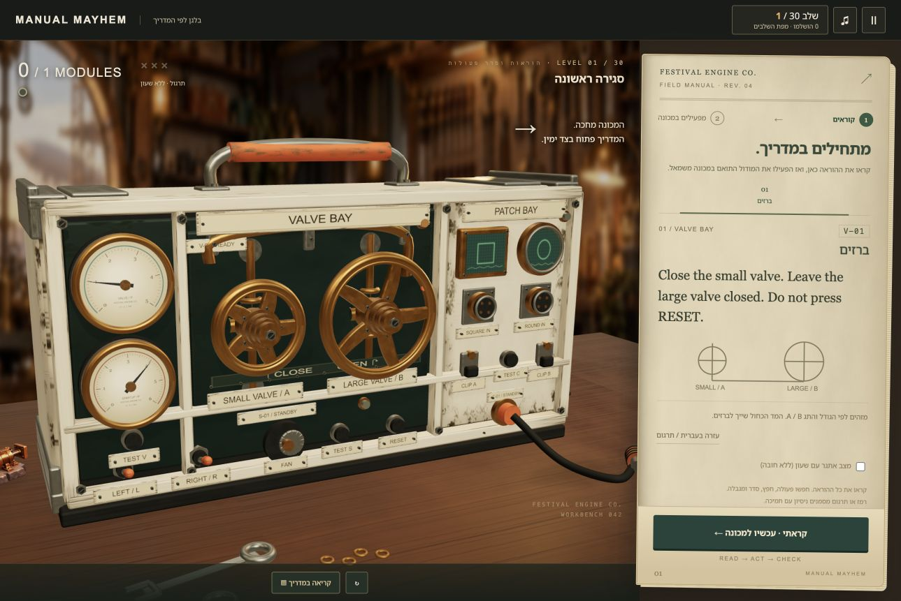

# Manual Mayhem — בלגן לפי המדריך

An original harmless festival-engine adaptation of **Keep Talking and Nobody Explodes**: inspect a changing tangible machine, consult a separate manual, communicate a precise procedure and operate valves, cables and relays. Three strikes shut the test down; recovery restores a module, startup brings back the score.

## Play locally

```sh
npm ci
npm run dev
```

Open http://localhost:5262/ . Production preview: `npm run build && npm run preview` → http://localhost:4262/ . Ports are strict. No backend, AI runtime, keys or accounts. All assets are local. Source and public repository: https://github.com/AceDZN/manual-mayhem . No production deployment.

Start at level1 and advance through30 progressively harder levels. Completing a level opens the next; the level map lets you replay unlocked levels, and progress resumes locally after reload. There is no grade selector or grade limit. Start enables audio. Click a module to inspect it straight on; its matching manual page stays available. Use the physical controls, or open “כפתורי הפעלה” for labeled keyboard/touch buttons. Drag the handle/background to rotate the overview. Turn wheels by rim drag/click; drag the orange OUT cable to the socket under the described screen. The manual is visible immediately. Read the matching page, then choose its operation action; M switches reading/operation focus; Esc closes the active view; 1/2/3 inspect modules; Tab/Enter operate buttons; F toggles fullscreen. Left/right always refer to facing the module. No movement controls or pointer lock.

Solo contextual-manual play is complete. The first action explicitly asks the player to read before operating; wide layouts keep the paper beside the machine, while narrow app panels and phones have explicit reading/operation phases. For a real human reader, open `?manual=1` on a separate screen (or `/manual` with a SPA fallback). The reader page is static: no live answers, machine state, microphone, account or sync. It can be printed.

Practice has no clock. Optional challenge time stops during inspection, manual, translation, pause and settings. A hint/translation, retry, mistake or reviewed message selection is recorded locally; prior attempts survive level changes and reloads; the campaign saves unlocked levels and best results separately; successful play does not imply retained mastery or speaking assessment. RESET is a physical action that can violate a prohibition. “איפוס לצורך ניסיון חוזר” is an external recovery affordance.

## Learning scope

One continuous30-level campaign, available to every player:

- Levels1–3 introduce valves, cable and relays separately;4–6 combine two active bays.
- Levels7–10 combine all three with changing initial states, negation and longer procedures.
- Levels11–20 add passive receivers, event order and precise messages for an operator.
- Levels21–23 separate maintenance history from current working condition.
- Levels24–26 require repeated calibration from fixed conditional rules, including all four valve combinations.
- Levels27–30 add startup predictions, changing pressure thresholds, opposite fan plans and a mixed final challenge.

The difficulty changes actual valid actions and decisions, with no grade gating. The original source grades are curriculum provenance only. See [the campaign map](docs/CAMPAIGN.md) and `src/campaign.ts` for the30 authored procedures.
Exact Workbook sources and evidence limits: `CURRICULUM.md`, `coverage.json`, `COVERAGE.md`. Selected rules only: no complete-chapter coverage, spontaneous writing, live speaking/listening, full tense system or second conditional claim.

## Assets and audio

`ASSET_SEARCH.md` records six live Chrome Tripo gallery searches and owned-asset inspection. Two locally bundled owned meshes are rigid machinery, with provenance/rights/size/rig status in `ASSETS.md`; no new generations or credits. Noto Sans Hebrew is OFL licensed.

The settings panel links a locally served 25-second preview at `/audio/manual-mayhem-preview.mp3`. `AUDIO.md` documents the original 32-bar ABAC electro-mechanical composition, module stems, ambience, eleven cues, independent music/SFX/voice/master gains, limiting and QA. Preview: `docs/audio/manual-mayhem-mix-preview.wav`. Audio/source is MIT; no source-game recordings. No spoken audio is bundled, so voice gain is reserved and labeled accordingly. Human audition is not claimed.

## Checks and evidence

`npm test` runs independent semantic fixtures; `npm run build` typechecks and produces static relative-base output. `window.render_game_to_text()` exposes current visible state and evidence without next-action solutions. `window.advanceTime(ms)` respects game pause and deterministic pressure stepping. Browser scripts/evidence are under scripts/, docs/playtest/, docs/qa/ and docs/audio/; `PLAYTEST.md` and `VISUAL_REVIEW.md` state completed checks and limitations.

The image in `docs/visual-targets/gameplay-mockup.png` is an AI-generated **design target**, never presented as working gameplay. See its exact prompt and built-in generation record in the same folder. Gameplay captures are separately named.

## Actual gameplay



[Current30-level browser verification](docs/qa/campaign/campaign-results.json) records the complete sequential campaign. The [historical60-second manual → mistake → recovery → physical cable → startup sequence](docs/qa/source-sequence/README.md) demonstrates the original release’s source loop; current campaign captures are under docs/qa/campaign. The imagegen design target is labeled separately.

The visual/manual revision requested by the human is documented with real desktop/mobile captures and regression evidence in [docs/qa/revision](docs/qa/revision/REVISION.md). The initial flat renderer and hidden-manual interface are superseded.

## Workbook player integration

Workbook's English Games host embeds the versioned static bundle. `?level=1..30` opens a lesson's requested stage and keeps the manual visible first. An explicit lesson entry opens access to that point; it never marks earlier stages complete. Ordinary visits keep the saved sequential campaign. Completing a direct-linked final stage is labeled as that stage's success, rather than claiming the whole campaign was completed.

`src/host.ts` sends Workbook version1 `ready`, `level-start`, `level-complete` and bounded `error` messages to an exact trusted Workbook or loopback parent origin. Standalone play is silent. Ready follows all workshop textures, the backdrop, both models and a real render; a required-asset failure cannot report ready. Completion follows the actual engine-start win. Operation duration excludes manual reading, settings, pause, map and background time. The actual gameplay poster and host evidence are under `workbook/` and `docs/qa/workbook-host/`.
